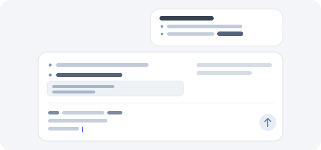

# dsh-composer-md-preview

Markdown rendering for your own messages in DeepSeek Harness: a live preview
card above the composer while you type, and the same rendering for the messages
you have already sent.



## Install

```sh
# from GitHub
dsh plugin --profile web add github:wangjiaxi/dsh-composer-md-preview

# from a local checkout (linked, so edits take effect on the next recompose)
dsh plugin --profile web add /path/to/dsh-composer-md-preview
```

Reload the page once. The plugin shows up as **Markdown preview** in
Settings → Plugins, and the `MD` pill appears in the composer tool row.
Requires DSH `0.2.2-rc.3` or newer within the `0.2.x` line.

## What it does

Two halves of one idea — your Markdown reads as Markdown, not as markers.

1. **Draft preview.** A card docked directly above the input box renders the
   draft as you type. It appears only when the draft actually contains Markdown
   syntax, so plain prose is never duplicated above the input box.
2. **Sent messages.** A message you send renders as Markdown in the
   conversation, in the same bubble as before, using the same renderer as the
   draft card. Assistant messages were always rendered; now your own messages
   match them.
3. **Pasted code.** Pasting a code chunk into the composer wraps it in a fenced
   block, with the language named when it can tell — no more hand-typing three
   backticks around a function.

The `MD` button in the composer tool row is the master switch for both. Turn it
off and the card disappears and your messages show their raw text again. The
choice is stored in `localStorage` (`dsh-composer-md-preview/v1`), so it
survives a reload and applies to every session.

## Pasted code

Paste a snippet and it arrives as a Markdown fenced block, so the preview card
and the sent message both show it as a code block:

````text
before:  function f() { return 1 }        after:  ```javascript
                                                  function f() { return 1 }
                                                  ```
````

- **It decides, conservatively.** A paste is fenced only when it reads as source
  (at least two lines, code punctuation/indentation/keywords/commands, not
  mostly prose). A paragraph, a shopping list, a single word or a URL is left
  exactly as pasted.
- **Language names.** JavaScript, TypeScript, Python, C, C++, Go, Rust, Java,
  SQL, HTML, JSON, YAML, CSS, Shell scripts and diffs are recognized; anything
  else gets an unlabeled block.
- **Escapes.** Hold **Shift** while pasting (`Ctrl+Shift+V` / `⇧⌘V`) to keep the
  text verbatim. You can also turn the rewrite off in **Settings → General →
  Fence pasted code**; the switch is remembered per browser.
- **Nothing is destroyed.** The insert goes through the shell's own
  `insertText` action at the captured caret, so it is one undo step; if the
  composer is busy or the paste carries files, the paste is left to the browser.
  Chromium keeps the paste clipboard read-only, which is why the plugin inserts
  the fenced block instead of rewriting the clipboard.
- Already-fenced text is never re-wrapped.

## Where it appears

| Registration | Slot | What it is |
| --- | --- | --- |
| `conversation.input.dock` | `id: composer-md-preview`, order 10 | the preview card, docked beside the Todo and queue cards |
| `conversation.input.left` | `id: composer-md-preview-toggle`, order 100 | the `MD` pill in the composer tool row |
| `conversation.user.text.node` | `key: text`, priority 50 | Markdown rendering for the text of a sent message, shadowing the shipped plain-text run (keyed dispatch renders the lowest priority) |
| `settings.general.item` | `id: composer-md-preview-autofence`, order 30 | the **Fence pasted code** switch in Settings → General |

## Supported syntax

Headings (`#`–`######`), paragraphs with hard line breaks, bold/italic/
strikethrough, inline code, fenced code (with a language label), bullet and
numbered lists (nesting, start numbers, `- [ ]` task boxes), blockquotes,
tables with column alignment, thematic breaks, links and images.

Only `http(s)` and `mailto` links become clickable anchors; raw HTML stays
literal text, and images render as titled placeholders instead of being
loaded, so an untrusted message cannot fetch a tracking pixel.

Deliberate simplifications: no syntax highlighting, no TeX math, no footnotes
or reference-style links, and reference-style definitions render literally.

## What does not change

- The **session log keeps the original Markdown**, byte for byte. This is a
  rendering layer only: `copy`/export, other clients, and the model all see the
  raw text the model received.
- The model still receives raw Markdown — the preview never rewrites what you
  send.
- Selecting text inside a rendered message copies what you see on screen, not
  the source. Use the session log to recover the raw Markdown.
- The card never renders a draft longer than 50 000 characters (it says so in
  its header); such a draft stays raw.

## Notes

- Every color, surface, type size and radius comes from the host's theme tokens
  (`--dsw-alias-*`, `--dsw-*`), so light/dark themes and the user's font-size
  preference are followed automatically.
- The card matches the dock cards' geometry (`--dsh-composer-dock-inset`) and
  uses an inset scroll region capped at `min(34vh, 320px)`.
- The renderer is local to this package: no Harness Client package is imported,
  so a renamed internal primitive cannot blank a transcript.
- English and Chinese UI strings ship in the same bundle.

---

# 中文

把你自己的消息按 Markdown 渲染：输入时看到实时预览，发送后看到的也是渲染结果。

安装：`dsh plugin --profile web add github:wangjiaxi/dsh-composer-md-preview`，刷新一次页面——插件页显示「Markdown 预览」，输入框工具行出现 `MD`。要求 DSH `0.2.2-rc.3` 及以上（0.2.x 线）。

- **草稿预览**：输入框正上方一张卡片实时渲染草稿；只有草稿里出现 Markdown
  语法时才会出现，普通文字不会在输入框上方重复一遍。
- **已发送消息**：发送出去的消息在对话里也按 Markdown 渲染（和助手消息一样），
  位置和气泡样式不变。
- **粘贴代码自动加代码块**：把一段代码粘进输入框，会自动包成围栏代码块并尽量标上
  语言（JS/TS/Python/C/C++/Go/Rust/Java/SQL/HTML/JSON/YAML/CSS/Shell/diff）；
  普通文字、列表、单个词、链接都不会被改动。按住 **Shift** 粘贴保持原文，
  也可以在 **设置 → 通用 → 粘贴代码自动加代码块** 里关掉。
- **总开关**：输入框工具行的 `MD` 按钮同时管两件事；关掉后卡片消失、已发送的
  消息恢复原文显示。状态存在 `localStorage`（`dsh-composer-md-preview/v1`）。
- 支持：标题、段落（保留换行）、粗体/斜体/删除线、行内代码、带语言标签的围栏
  代码块、有序/无序/嵌套列表、`- [ ]` 任务框、引用、带对齐的表格、分隔线、链接
  和图片；只有 `http(s)` / `mailto` 可点击，原始 HTML 按文本显示，图片只占位不加载。
- 不改任何数据：会话记录里仍是原始 Markdown，模型收到的也是原始 Markdown；
  在渲染后的消息里选中复制，得到的是屏幕上的文字而不是源码。
- 有意不做：语法高亮、TeX 公式、脚注与引用式链接定义。

[](https://github.com/deepseek-ai/deepseek-harness)
